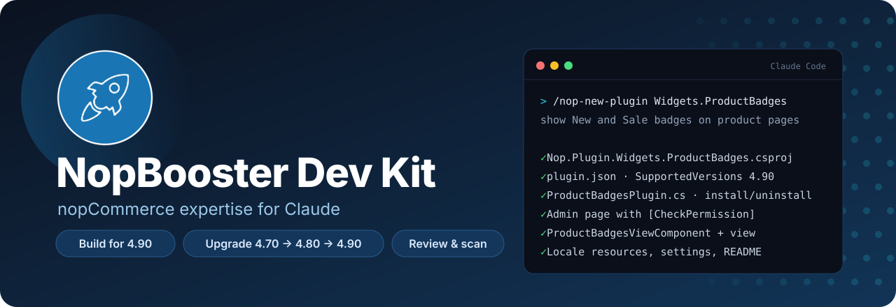
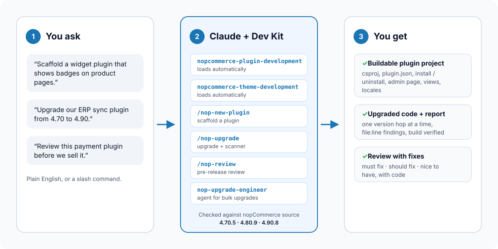
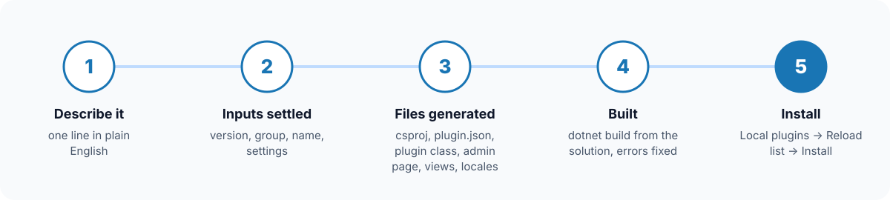
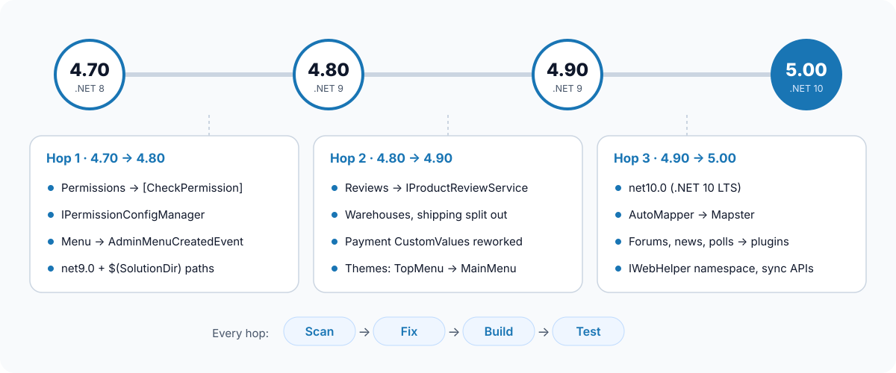
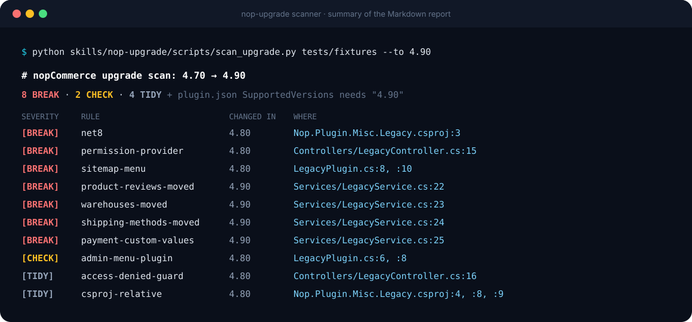

<p align="center">
  
</p>

<p align="center">
  <a href="LICENSE"></a>
  
  
  
  <a href="https://github.com/nopbooster/nopbooster-dev-kit/actions"></a>
</p>

<p align="center">
  <b>Build nopCommerce 4.90 plugins and themes with Claude — and upgrade your custom code from 4.70 and 4.80.</b><br>
  Made by <a href="https://www.nopbooster.com">NopBooster</a> · Creatrix Technologies
</p>

---

Claude knows ASP.NET Core well, but nopCommerce only roughly. Ask it for a plugin and it often targets the wrong .NET version, uses APIs that were removed two releases ago, or forgets the files nopCommerce needs to load a plugin at all.

**The NopBooster Dev Kit fixes that.** It is a Claude plugin that gives Claude accurate, version-specific nopCommerce knowledge, plus commands to scaffold plugins, upgrade old code and review work before release. Every version fact in it was checked against the real nopCommerce source code of **4.70.5, 4.80.9 and 4.90.8**.

## Contents

- [What's inside](#whats-inside)
- [How it works](#how-it-works)
- [Install](#install)
- [Quick start](#quick-start)
- [Build a new plugin](#build-a-new-plugin)
- [Upgrade 4.70 / 4.80 → 4.90](#upgrade-470--480--490)
- [Review before release](#review-before-release)
- [Themes](#themes)
- [Version coverage](#version-coverage)
- [How the knowledge was verified](#how-the-knowledge-was-verified)
- [Repository layout](#repository-layout)
- [FAQ](#faq)
- [Contributing](#contributing)
- [Need a hand?](#need-a-hand)

## What's inside

| | Name | What it does |
|---|---|---|
| 🧠 | **nopcommerce-plugin-development** | Loads automatically whenever you work on plugin code. Project setup, `plugin.json`, install/uninstall, admin pages and menus, permissions, settings, migrations, events, widgets, scheduled tasks — for 4.90, with the 4.70/4.80 differences. |
| 🎨 | **nopcommerce-theme-development** | Loads automatically for storefront themes: `theme.json`, view overrides, CSS, RTL, and what changed between versions. |
| ⚡ | **`/nop-new-plugin`** | Scaffolds a complete, buildable plugin from one sentence. |
| 🔁 | **`/nop-upgrade`** | Upgrades a plugin or theme one version at a time, guided by a scanner that lists breaking code by file and line. |
| 🔍 | **`/nop-review`** | Reviews a plugin or theme for bugs, security, conventions and future upgrade cost. |
| 🤖 | **nop-upgrade-engineer** (agent) | Works through many plugins or a whole theme, one at a time, until each builds. |

## How it works

<p align="center">
  
</p>

You talk to Claude normally. When the conversation is about nopCommerce, Claude loads the right part of the Dev Kit on its own — only the reference it needs, so it stays fast. Slash commands are there when you want a specific workflow.

## Install

### Claude Code

```text
/plugin marketplace add nopbooster/nopbooster-dev-kit
/plugin install nopbooster-dev-kit@nopbooster
```

Restart Claude Code, then type `/nop` to see the commands.

> **Once the plugin is approved in the Claude plugin directory**, it will also install with
> `/plugin install nopbooster-dev-kit@claude-plugins-official`, or from **/plugin → Discover**.

### Claude app (desktop and web)

Plugins are available on paid Claude plans (Pro, Max, Team, Enterprise).

1. Open the **Plugins** area in Claude.
2. Choose to add a marketplace **from a repository**, and enter `nopbooster/nopbooster-dev-kit`.
3. Install **NopBooster Dev Kit** from that marketplace.

### Try it from a local copy (for contributors)

```bash
git clone https://github.com/nopbooster/nopbooster-dev-kit.git
claude --plugin-dir ./nopbooster-dev-kit
```

### What you need for building

- The nopCommerce **source code** of your target version (from [GitHub releases](https://github.com/nopSolutions/nopCommerce/releases)).
- **.NET 9 SDK** for 4.80 / 4.90, or **.NET 8 SDK** for 4.70.
- Python 3 (standard library only) if you want to run the upgrade scanner yourself.

Without a nopCommerce source tree Claude can still write the code; it just can't build it to prove it compiles.

## Quick start

Open Claude Code in the root of your nopCommerce source (the folder that contains `src/NopCommerce.sln`) and try one of these:

```text
/nop-new-plugin Widgets.ProductBadges show "New" and "Sale" badges on product pages, configurable per store
```

```text
/nop-upgrade src/Plugins/Nop.Plugin.Misc.MyErpSync
```

```text
/nop-review src/Plugins/Nop.Plugin.Payments.MyGateway
```

Or just ask in your own words:

- *"Add an admin menu item for my plugin under Configuration."*
- *"This controller is from 4.70 — make it work on 4.90."*
- *"Add a custom permission so only the Warehouse role can open this page."*
- *"Override the product page in my theme to show the SKU under the title."*

## Build a new plugin

<p align="center">
  
</p>

`/nop-new-plugin` turns one sentence into a complete project, not a skeleton with TODOs.

**1. Describe it.** For example: *"a widget that shows a delivery-time message on the product page, with the text editable per store."*

**2. Claude settles the details** and only asks if something can't be sensibly defaulted:

| Input | Default |
|---|---|
| Target version | 4.90, or whatever your solution is (read from `NopVersion.cs`) |
| Group | Inferred: shows content → `Widgets`, takes payment → `Payments`, otherwise `Misc` |
| Name | From the description, e.g. `DeliveryMessage` |

**3. Files are generated**, following the same patterns as nopCommerce's own plugins:

```text
src/Plugins/Nop.Plugin.Widgets.DeliveryMessage/
├── Nop.Plugin.Widgets.DeliveryMessage.csproj   net9.0, $(SolutionDir) paths, ClearPluginAssemblies
├── plugin.json                                 SupportedVersions ["4.90"]
├── DeliveryMessagePlugin.cs                    install / uninstall, widget zones
├── DeliveryMessageSettings.cs                  per-store settings
├── DeliveryMessageDefaults.cs
├── Controllers/DeliveryMessageController.cs    [CheckPermission], multi-store config
├── Models/ConfigurationModel.cs
├── Components/DeliveryMessageViewComponent.cs
├── Infrastructure/RouteProvider.cs
├── Views/Configure.cshtml · PublicInfo.cshtml · _ViewImports.cshtml
└── README.md
```

**4. It builds.** Claude adds the project to `NopCommerce.sln`, runs `dotnet build`, and fixes errors in the new project.

**5. Install it** in your store: restart → **Admin → Configuration → Local plugins** → **Reload list of plugins** → **Install** → **Configure**.

Everything the plugin adds on install (settings, locale strings, widget activation, scheduled tasks, permissions, tables) is removed again on uninstall.

## Upgrade 4.70 / 4.80 → 4.90

<p align="center">
  
</p>

Upgrades go **one version at a time**. For each hop, `/nop-upgrade`:

1. **Scans** the code for known breaking changes.
2. **Fixes** them the way nopCommerce's own plugins were changed, without renaming settings, locale keys, tables or URLs, so existing stores keep their data.
3. **Builds** against the target version.
4. **Tells you what to test**, and what the store owner must do (for example, re-assign custom role permissions after 4.70 → 4.80).

### The upgrade scanner

<p align="center">
  
</p>

The scanner is a small Python script with no dependencies. Claude runs it for you, but you can also run it yourself:

```bash
python skills/nop-upgrade/scripts/scan_upgrade.py path/to/your/plugins --to 4.90
```

It detects your current version from `plugin.json` (or pass `--from 4.70` / `--from 4.80`) and prints a Markdown report:

| Severity | Meaning |
|---|---|
| **BREAK** | Will not compile or run on the target version. |
| **CHECK** | Compiles, but may behave differently — look at it. |
| **TIDY** | Recommended to match how nopCommerce now does it. |

What it knows about:

| Hop | Main changes detected |
|---|---|
| **4.70 → 4.80** | net8.0 → net9.0 · `StandardPermissionProvider` and `IPermissionProvider` removed → `StandardPermission` + `[CheckPermission]` + `IPermissionConfigManager` · `SiteMapNode` admin menu removed → `AdminMenuCreatedEvent` · `IAdminMenuPlugin` obsolete · `.csproj` moved to `$(SolutionDir)` paths · `ILogger` return types · `AddStoreTokensAsync` / `SendCampaignAsync` new `languageId` · removed `IAclSupportedModelFactory`, `ILocalizedEnum`, product flag helpers |
| **4.80 → 4.90** | Product reviews → `IProductReviewService` · warehouses → `IWarehouseService` · shipping methods → `IShippingMethodsService` · payment custom values and `OrderPaymentInfo` session reworked · `IPlugin.InstallSampleDataAsync` · specification / product attribute / newsletter / topic API changes · token events moved namespace · PDF documents rewritten · Azure Blob moved to a plugin · menu settings removed · `TopMenu` → `MainMenu` |

The full lists, with before/after code, are in [`skills/nop-upgrade/references`](skills/nop-upgrade/references).

> The scanner finds known patterns; the compiler finds the rest. Always build afterwards — the upgrade skill does.

### Many plugins at once

Ask for the upgrade engineer, e.g. *"Use the nop-upgrade-engineer to upgrade everything in src/Plugins/Custom to 4.90."* It scans everything first, then upgrades and builds each plugin in turn and returns a status table.

## Review before release

`/nop-review` checks a plugin or theme against a release checklist and leads with a verdict — *ship*, *ship after fixes*, or *not ready* — followed by findings with file and line:

- **Packaging** — `plugin.json`, `.csproj`, content files, no edits to core.
- **Install / uninstall symmetry** — nothing left behind.
- **Security** — permissions on every admin action, antiforgery, webhook validation, output encoding, no secrets in code, multi-store and ACL respected.
- **Correctness and performance** — fully async, no N+1 queries, caching, safe event consumers, proper `HttpClient` use.
- **Conventions** — naming, localization, models, widget behaviour.
- **Upgrade cost** — how much work the next nopCommerce version will be.

## Themes

The theme skill covers `theme.json`, how view overrides work, registering CSS, RTL, scripts, and selling themes. It also knows what breaks themes between versions — most importantly in 4.90, where the header **TopMenu** was replaced by **MainMenu** and **FooterMenu**, and 176 public views changed. `/nop-upgrade` has a dedicated theme procedure that re-merges your overridden views onto the new core views instead of keeping stale copies.

## Version coverage

| nopCommerce | .NET | Build new code | Upgrade to it from |
|---|---|---|---|
| **4.90** | 9 | ✅ default | 4.80, 4.70 |
| **4.80** | 9 | ✅ on request | 4.70 |
| **4.70** | 8 | ✅ on request | — |

Minor releases are covered by their major version (e.g. everything for 4.90 applies to 4.90.0 – 4.90.8). Versions before 4.70 are not covered.

## How the knowledge was verified

Rather than relying on blog posts or memory, the Dev Kit's version facts come from comparing the nopCommerce source code itself at tags `release-4.70.5`, `release-4.80.9` and `release-4.90.8`:

- plugin project files, `plugin.json` and code of the core plugins (Google Analytics, Zettle, Pickup in Store);
- public service interfaces in `Nop.Services`, diffed signature by signature between versions;
- `Nop.Web.Framework` (admin menu, permissions, URL helpers, startup order);
- public views and the DefaultClean theme.

The scanner has its own test suite (`tests/`), run on every push, using a deliberately outdated sample plugin.

## Repository layout

```text
nopbooster-dev-kit/
├── .claude-plugin/
│   ├── plugin.json            plugin manifest
│   ├── marketplace.json       lets this repo be added as a marketplace
│   └── icon.png
├── skills/
│   ├── nopcommerce-plugin-development/   auto-loaded knowledge + references/
│   ├── nopcommerce-theme-development/    auto-loaded knowledge
│   ├── nop-new-plugin/                   /nop-new-plugin
│   ├── nop-upgrade/                      /nop-upgrade + references/ + scripts/scan_upgrade.py
│   └── nop-review/                       /nop-review
├── agents/
│   └── nop-upgrade-engineer.md
├── tests/                     scanner self-test + sample 4.70 plugin
└── docs/images/               illustrations (regenerate with docs/images/generate.py)
```

## FAQ

**Does it work without the nopCommerce source code?**
Yes — Claude can write and explain code anywhere. To *build* and verify, open Claude in a nopCommerce source tree of the target version.

**Does it send my code anywhere?**
No. The plugin is instructions and one local Python script. It adds no servers or connections; your code is handled by Claude like any other project.

**Which version does it use if I don't say?**
It reads your solution's version. If there is none, it targets 4.90 and tells you so.

**Can it upgrade from 4.60 or older?**
Not yet. The scanner and references start at 4.70.

**Will the upgrade change my plugin's behaviour?**
It is told not to: settings keys, locale resource names, table names and URLs stay the same, and the plugin version is bumped with update migrations so stores upgrade in place.

**Is it free?**
Yes, MIT-licensed.

## Contributing

Found something that is wrong for a specific nopCommerce version, or a breaking change the scanner misses? Please [open an issue](https://github.com/nopbooster/nopbooster-dev-kit/issues/new/choose) with the version and a code sample. Pull requests are welcome — see [CONTRIBUTING.md](CONTRIBUTING.md).

## Need a hand?

The Dev Kit is made by **[NopBooster](https://www.nopbooster.com)**, part of Creatrix Technologies — nopCommerce themes, plugins, upgrades and developers for hire.

- Ready-made themes and plugins: [nopbooster.com](https://www.nopbooster.com)
- Custom development, upgrades and support: **sales@nopbooster.com**

## License

[MIT](LICENSE) © Creatrix Technologies (NopBooster).

nopCommerce is a trademark of Nop Solutions, Ltd. Claude is a trademark of Anthropic, PBC. This project is independent and not affiliated with or endorsed by either.
